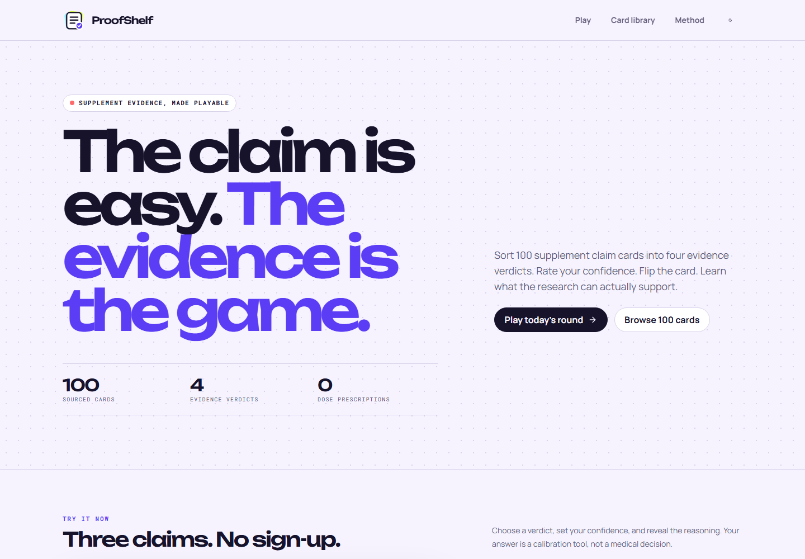
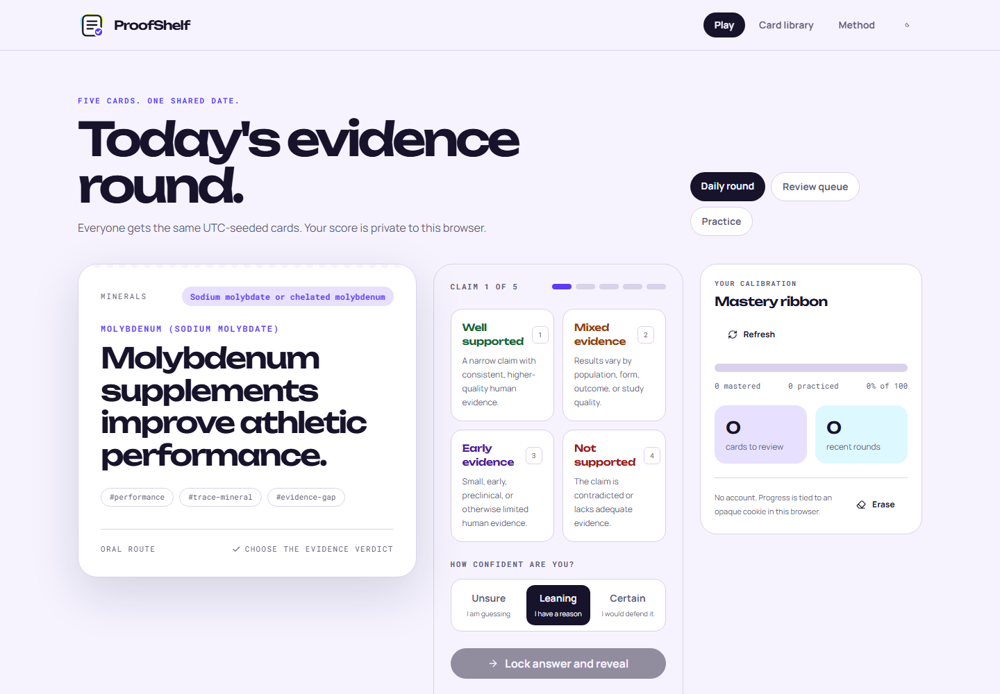
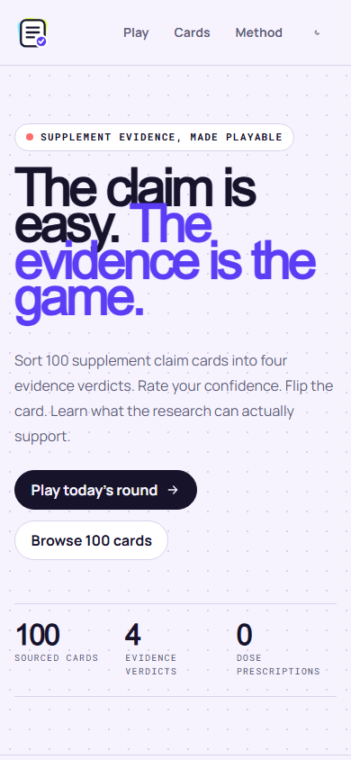

# ProofShelf

ProofShelf is a playable supplement evidence literacy game. Sort 100 sourced claim cards into four verdicts, rate your confidence, flip the evidence, and build a review queue from the claims that trip you up.

[](https://proofshelf-ashy.vercel.app)
[](https://github.com/devtechedge/proofshelf/actions/workflows/ci.yml)


## Live Demo

Open [proofshelf-ashy.vercel.app](https://proofshelf-ashy.vercel.app).

The public deployment uses a real Neon Postgres backend. No account or email is required. Progress is tied to an opaque httpOnly cookie in your browser, and the Erase control deletes the account and child rows. The three-card landing demo works without any database write.

## Screenshots

| Landing | Five-card game | Mobile |
| --- | --- | --- |
|  |  |  |

## What it does

- 100 researched supplement claim cards across nine categories.
- Four evidence verdicts: well supported, mixed, early evidence, and not supported.
- Confidence calibration that flags high-confidence misses.
- Deterministic UTC-seeded daily rounds.
- Review queues that prioritize weak and overconfident cards.
- Searchable library with category and verdict filters.
- Label Lens practice for forms, routes, serving language, and proprietary blends.
- Individual evidence cards with form, route, label clue, safety note, and source trail.
- Anonymous server-side progress with replay protection and one-click deletion.
- Light and dark themes, keyboard play, touch controls, and reduced-motion support.
- Method and safety pages that separate retailer discovery from clinical evidence.

## Evidence boundaries

NOW Foods and iHerb public pages were used only to identify commonly marketed ingredient families. ProofShelf does not claim a live top-100 sales ranking, popularity score, endorsement, or efficacy inference from retailer pages.

Evidence and safety context comes from NIH Office of Dietary Supplements, NCCIH, MedlinePlus, Cochrane, PubMed Central, PubMed, and FDA sources. Every card names its sources and a review date. Retailer links are labeled market discovery and never substantiate a health claim by themselves.

ProofShelf is educational. It does not diagnose, prescribe, recommend doses, verify product quality, or replace a qualified clinician or pharmacist.

## Stack

| Layer | Technology |
| --- | --- |
| Framework | Next.js 16 App Router, React 19 |
| Language | Strict TypeScript |
| Styling | Tailwind CSS 4, custom design tokens |
| Database | Neon Postgres through `pg` and Drizzle |
| Local and test database | Embedded PGLite with identical schema |
| Validation | Zod |
| Unit and integration tests | Vitest |
| Browser tests | Playwright, desktop and mobile Chromium |
| Accessibility | axe-core, WCAG A and AA checks |
| Hosting | Vercel with git-linked production deployments |
| CI and updates | GitHub Actions and Dependabot |

## Quick start

```bash
npm install
npm run dev
```

Open [http://localhost:3000](http://localhost:3000).

Without `DATABASE_URL`, the app uses in-memory PGLite and progress resets when the process restarts. To use Postgres, copy `.env.example` to `.env.local` and provide a real connection string. Never commit credentials.

## Verify

```bash
npm run lint
npm run typecheck
npm test
npm run build
npx playwright install chromium
npm run e2e
```

`npm run check` runs lint, strict typecheck, 25 unit and integration tests, and the production build. The 20-test Playwright suite covers the landing demo, daily round, persistence, replay protection, review mode, Label Lens, library search, card detail, theme persistence, 404, mobile overflow, and axe scans.

## Documentation

- [Architecture](docs/architecture.md)
- [Catalog methodology](docs/catalog-methodology.md)
- [API reference](docs/api.md)
- [Deployment](docs/deployment.md)
- [Security policy](SECURITY.md)

## License

MIT
